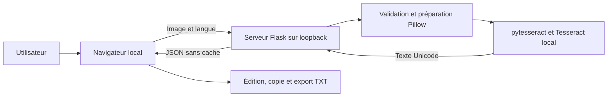

# SAD — Software Architecture Document

Version : 0.1 — 3 novembre 2026. Statut : architecture proposée pour le MVP.

## 1. Choix d’architecture

Une application locale composée d’une interface HTML/CSS/JavaScript sans framework et d’un petit serveur Python Flask. Pillow valide et prépare l’image ; pytesseract appelle Tesseract installé sur la machine. Ce choix évite un outil de compilation frontend, une base de données et un service distant.

Tesseract remplit la fonction OCR. Aucun LLM, service d’IA externe ou téléchargement de modèle à l’exécution n’est prévu. Les données OCR françaises et anglaises sont installées au préalable. Le moteur moderne peut employer des réseaux neuronaux spécialisés ; il ne s’agit pas d’un système génératif.

## 2. Composants et flux



1. Le serveur sert les ressources locales de l’interface ; aucune police, bibliothèque ou ressource CDN n’est chargée.
2. Le navigateur transmet une image et un choix de langue autorisé.
3. Le serveur vérifie les limites du corps HTTP, le format réel, les dimensions et le décodage. Les alertes de décompression excessive sont traitées comme des refus.
4. Pillow applique l’orientation EXIF et convertit l’image dans un mode compatible. Le serveur n’extrait ni ne journalise les métadonnées inutiles.
5. Le service OCR lance Tesseract avec un délai maximal de 30 secondes. Les arguments proviennent de valeurs contrôlées et aucun shell n’est invoqué.
6. Le serveur libère les images en mémoire et supprime les fichiers temporaires dans un bloc de nettoyage, quelle que soit l’issue.
7. Le navigateur affiche le texte comme valeur d’un champ éditable, jamais comme HTML. La copie et l’export utilisent cette valeur courante.

## 3. Organisation envisagée

```text
Extracteur_texte/
  docs/                   # Documentation de cadrage
  app/                    # À créer lors de l’implémentation
    __init__.py           # Construction et configuration Flask
    routes.py             # Interface, santé et API OCR
    ocr.py                # Validation, préparation et appel OCR
    templates/index.html
    static/               # CSS et JavaScript locaux
  tests/                  # À créer avec les jeux de référence
  requirements.txt        # À créer avec versions verrouillées
```

Cette arborescence décrit une cible ; seule la documentation est créée à ce stade.

## 4. Exécution et configuration

- Cible initiale : Linux, Python 3.12 et Tesseract 5.x ; versions exactes à valider lors de l’installation.
- Dépendances Python proposées : Flask, Pillow, pytesseract et Waitress pour servir l’application sans mode debug.
- Dépendances système : moteur Tesseract et données `fra` et `eng`.
- Adresse par défaut : `127.0.0.1:8000` ; une seule extraction active par instance.
- Démarrage : vérifier le binaire et les langues ; `/health` indique une indisponibilité si un prérequis manque.
- Installation connectée autorisée pour récupérer les dépendances ; fonctionnement quotidien hors ligne.
- Aucun secret, compte utilisateur ou service tiers requis.

L’installation et les commandes de lancement exactes seront documentées et testées avec l’implémentation. Aucun serveur n’est démarré par ce document.

## 5. Données et sécurité

L’image et le résultat existent seulement pour traiter la demande et afficher le résultat dans la page. Aucun stockage applicatif persistant, historique, localStorage ou base de données. Les journaux contiennent uniquement les événements techniques nécessaires, sans texte reconnu, image ou nom de fichier fourni par l’utilisateur.

Limiter les requêtes à une image de 10 Mio et 20 millions de pixels. Configurer la limite HTTP pour accepter cette image et une marge multipart bornée, puis vérifier séparément la taille exacte du fichier. Ne pas utiliser le nom d’import comme chemin de fichier. Si des fichiers temporaires sont nécessaires au moteur, utiliser un répertoire privé et les supprimer systématiquement.

Le service refuse les origines et hôtes inattendus pour éviter les appels depuis un site tiers ; aucune politique CORS permissive. Les réponses documentaires portent `Cache-Control: no-store`. L’exposition publique et l’usage partagé nécessiteraient une architecture supplémentaire d’authentification, quotas et isolation ; ils sont hors périmètre.

## 6. Arbitrages et limites

| Choix | Motif | Limite |
| --- | --- | --- |
| Tesseract local | OCR mature et open source | Qualité variable sur photos difficiles et manuscrit |
| Interface sans framework | Peu de dépendances et aucun build frontend | Fonctionnalités interactives volontairement simples |
| Serveur local Python | Intégration directe du moteur et validation d’image | Installation de Python et Tesseract nécessaire |
| Aucun stockage | Simplicité et confidentialité | Pas de reprise ni d’historique |
| Une extraction active | Ressources bornées | Usage mono-utilisateur |

## 7. Vérification de l’architecture

Les tests du SRS couvrent le parcours complet, les erreurs, l’absence de réseau, les limites de ressources et le nettoyage. Vérifier particulièrement la terminaison du sous-processus après expiration du délai et le nettoyage après une exception. Les objectifs de mémoire, rapidité et précision restent à mesurer avant de confirmer cette architecture.

Avant distribution, vérifier les licences des versions retenues et des données OCR. Tesseract est sous Apache-2.0 ; la licence du code de ce projet reste à choisir.

## 8. Évolution implémentée : préparation et précision

Le projet est distribué sous MIT. `app/preprocess.py` ajoute OpenCV headless et NumPy pour les transformations et les filtres. `app/ocr.py` valide les images, applique l’orientation EXIF et appelle cette préparation avant Tesseract. Le serveur accepte les réglages dans le champ multipart `options`, tout en conservant la compatibilité sans ce champ.

Le navigateur présente un canvas orienté avec sélection de quatre coins, doublé de champs numériques accessibles. Les coins normalisés sont relatifs à l’image orientée. Le pipeline et ses plafonds de ressources sont décrits dans [ACCURACY.md](ACCURACY.md). L’accumulation de zones est locale dans le champ texte, sans base de données ni interprétation automatique des champs. Le benchmark génère ses propres images et ne conserve aucune donnée personnelle.

Windows dispose de `scripts/setup.ps1` avec contrôle des données OCR par SHA-256 et détection du chemin standard Tesseract ; la validation native Windows reste à effectuer.

## 9. Repérage ciblé sans entraînement

`app/fields.py` constitue le moteur déterministe de libellés et règles. Il reçoit les boîtes OCR sur l’image préparée, regroupe les lignes, trouve les libellés, associe des candidats proches et valide les formats. Il ne retourne que les sept clés autorisées et leurs indices de repérage. Tesseract utilise `image_to_data` pour ce parcours ; le worker Paddle transmet les polygones de lignes, sans changer ses modèles.

L’API utilise `structured=true` par défaut et renvoie le résumé filtré avec les champs. L’ancien texte libre reste disponible uniquement avec `structured=false` explicite pour compatibilité technique ; l’interface ne le demande pas. Le navigateur propose sept champs éditables et des exports filtrés TXT/JSON. Le traitement ne stocke aucun document ni historique. Les détails et limites sont définis dans [FIELDS.md](FIELDS.md).

## 10. Pipeline CNI à zones fixes et interface séquentielle

`app/cni_templates.json` définit le profil provisoire du recto fourni et sept boîtes normalisées. `app/cni.py` décode les images, cherche un quadrilatère de carte, projette vers le cadre canonique, découpe les valeurs et contrôle leur format. La classification ancien/nouveau n’est pas implémentée. Le verso est décodé et conservé seulement dans la session navigateur pour relecture, sans OCR de ses champs.

Le worker CNI charge une fois `TextRecognition` et le modèle latin local, puis traite les sept découpes avec association explicite au champ. Le détecteur généraliste n’est pas utilisé sur ce chemin ; il subsiste dans l’ancienne API. `zone_status()` contrôle le manifeste et le marqueur d’essai direct. `/health` reflète ce moteur principal. Le navigateur ne présente qu’une étape à la fois et n’envoie aucun réglage technique. Contrats et limites : [CNI_ZONES.md](CNI_ZONES.md).
